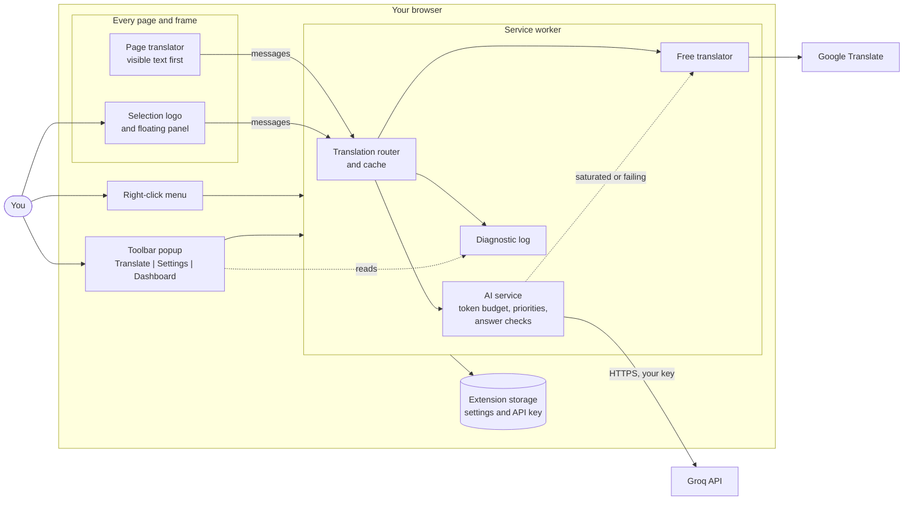
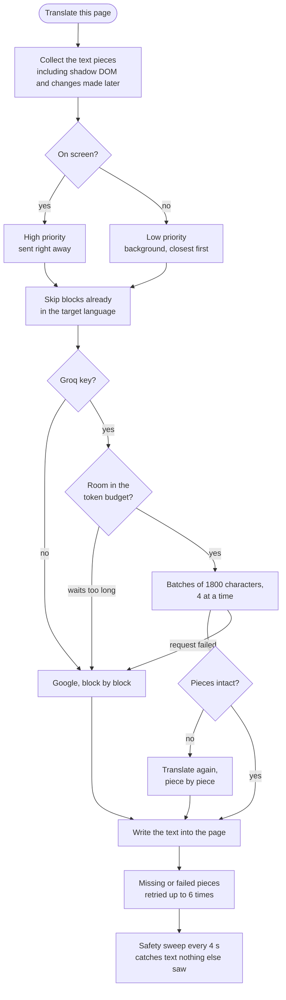

# Translate Express

A small browser extension (Chrome, Brave, Edge - Manifest V3) that translates web pages, selected text and what you write, with zero configuration.

It is a fork of [TWP - Translate Web Pages](https://github.com/FilipePS/Traduzir-paginas-web) (version 10.2.5.0, branch `chrome-mv3`) by FilipePS, reduced to the essentials and extended. All credit for the page-translation engine goes to the original project and its contributors.

## What it does

- **Right-click menu**: translate selection, translate what you are writing, translate this page / show the original, message window, Groq key, dashboard. The extension's icon opens the same popup.
- **Selection logo and small floating panel** next to the selected text (like DeepL), on any page, including text fields and rich-text editors: a copy button, a "Translate again" button and, in text fields, a Replace button. Translations already obtained are kept in memory.
- **Two languages**: "Read in" (default French) for text you read, "Write in" (default English) for text you write. Both are remembered.
- **Complete page translation**: dynamic content, text changed in place, shadow DOM, tall blocks, `<code>` that contains prose, pages that mix languages. Visible text first, the rest in the background.
- **Optional AI translation with Groq**: paste a Groq API key (stored only in the extension's local storage) and pick a model, or leave the default. Without a key, it uses Google Translate. A token budget keeps within the free tier's limit and falls back to Google when Groq is saturated.
- **Toolbar popup** (like a VPN extension): the message window, the settings (languages, Groq key) and a diagnostics dashboard that shows why a page is slow or incomplete, with a copyable report.
- **Interface language** selectable in the settings (English, Français), following the browser by default. Adding a language is one file.
- Dark theme everywhere.

## How it fits together



The page scripts never see the API key: only the service worker and the extension's own pages (the popup) read it.

### What happens when a page is translated



## Install

Works in Chrome, Brave and Edge (Manifest V3). Not in Firefox.

1. Download `translate-express-<version>.zip` from the [Releases](../../releases) page and unzip it (or clone this repository and use its `src` folder).
2. Open `chrome://extensions` (or `brave://extensions`, `edge://extensions`) and enable **Developer mode**.
3. Click **Load unpacked** and select the unzipped folder (the one that contains `manifest.json`).

The folder must stay where it is: the browser reads the extension from it, and there is no automatic update (download the new version and reload it).

Then select some text and click the logo that appears, or right-click a page. For AI translation, open the popup (the extension's icon), **Settings**, and paste a [Groq](https://console.groq.com/keys) API key: it is optional, the free Google translator is used without it.

While developing, the extension reloads itself within about 30 seconds of a file change (reload open pages with F5).

## Tests

```
node --test "tests/*.test.js"
```

The page, panel, popup and settings tests use [jsdom](https://github.com/jsdom/jsdom); install it first (`npm install jsdom`) or those tests are skipped. The continuous integration installs it, so all the tests run there.

## More

- [NOTES-LLM.md](NOTES-LLM.md): design notes (menu, languages, priorities, token budget, resilience, diagnostics, update procedure).
- [PRIVACY](PRIVACY): what is sent where.

## Security

See [SECURITY.md](SECURITY.md) to report a vulnerability and for how the API key is protected.

## License

[Mozilla Public License 2.0](LICENSE), inherited from the original project. Modified files keep their original notices.
